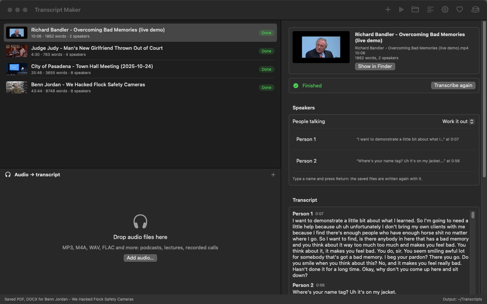
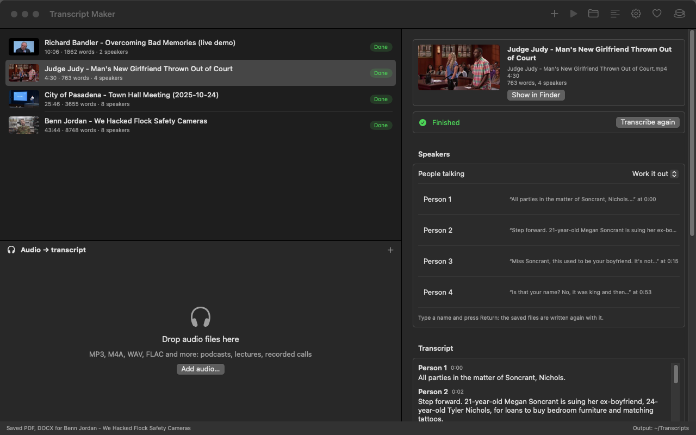
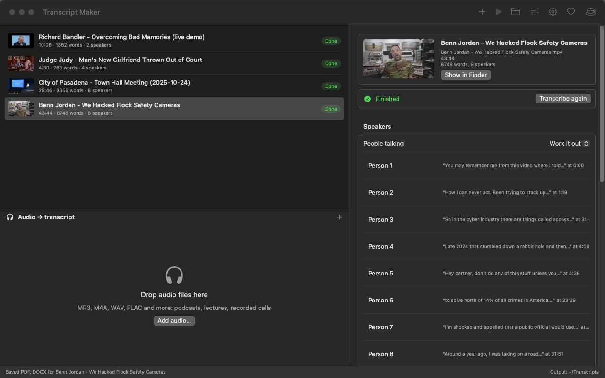
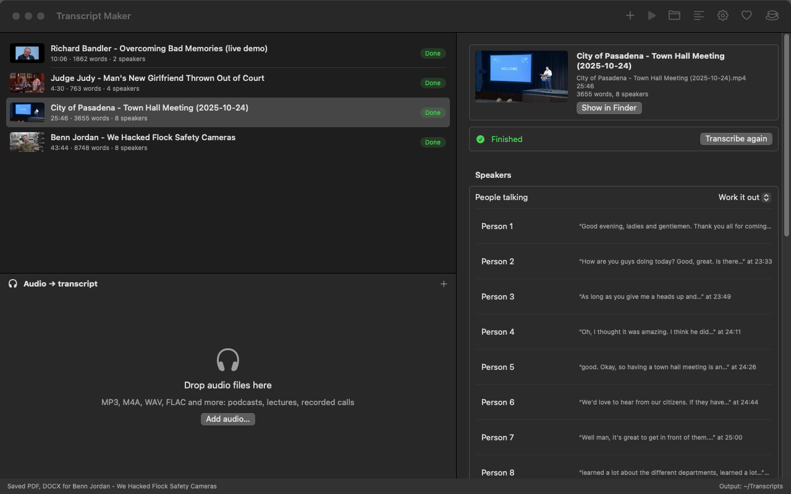

# Transcript Maker

A Mac app that turns videos and recordings into word-for-word transcripts, with each speaker labeled
(Person 1, Person 2, …). Made for studying lectures and webinars, preparing for tests, and looking closely at
how people talk: every "um", "uh", false start and repeated word is kept.

Everything runs on your Mac. Nothing is uploaded.



## Download

**[Transcript Maker (offline).dmg](https://github.com/TechnAudioToolz/video-audio-to-transcript/releases/latest)**:
the app with everything inside (speech recognition, speaker and sound clean-up models, ffmpeg), about 610 MB.
It needs no internet connection, ever.

1. Open the DMG and drag Transcript Maker onto Applications.
2. The first time, macOS may say it can't check the app (it's free and not registered with Apple):
   System Settings > Privacy and Security > scroll down > **Open Anyway**. Only once.

Needs macOS 14 Sonoma or newer on Apple Silicon (M1 or later).

## What it does

- **Drop videos on top, audio below.** MP4, MOV, M4V, MKV, WebM, AVI and more; MP3, M4A, WAV, FLAC and more.
  Files are transcribed one after another, in the order shown; the arrows change the order.
- **Who said what.** Voices are told apart automatically. If you know how many people talk, say so for better
  results. Rename "Person 1" to "Teacher" and the saved files are written again.
- **Save as** PDF and Word (DOCX), plus plain text, SRT and VTT subtitles if you like, with timestamps before
  each paragraph so a passage is easy to find in the video.
- **Optional sound clean-up** (Off, Gentle, Strong) for recordings that are hard to hear. See below for how much
  it helps (not much: the speech model already copes well).
- **Toolbar:** add files, pause, stop, the output folder, verbose mode (what the engine is doing), settings,
  donate, and a coffee cup that keeps the Mac awake for long queues.

The four example videos below, 85 minutes in all, took about 6 minutes. The first transcript after installing
takes a minute or two longer while macOS prepares the models.

## Examples

Four YouTube videos, transcribed with the app as it is, nothing corrected by hand. The speakers are left as the
app named them.

| Video | Length | Words | Speakers found |
|---|---|---|---|
| [Richard Bandler: overcoming bad memories, live demo](https://www.youtube.com/watch?v=hmQ7WozyJjo) | 10 min | 1,862 | 2 |
| [Judge Judy: man's new girlfriend thrown out of court](https://www.youtube.com/watch?v=98TEvpSfF2I) | 4½ min | 763 | 4 |
| [City of Pasadena town hall meeting, October 2025](https://www.youtube.com/watch?v=f40SkkwO-ac) | 26 min | 3,655 | 8 |
| [Benn Jordan: We Hacked Flock Safety Cameras](https://www.youtube.com/watch?v=uB0gr7Fh6lY) | 44 min | 8,748 | 8 |

The full transcript of the public town hall meeting is in [`examples/`](examples) (PDF and Word). The other
three videos belong to their makers, so here are only a few lines of each.

**Richard Bandler**, a live demonstration with a volunteer (shown at the top of this page):

> **Person 2** 0:56 — Where's your name tag? Uh it's on my jacket.<br>
> **Person 1** 0:58 — Are you really in this seminar?<br>
> **Person 2** 0:59 — Yes, sir.

Every "uh" is kept. One slip: "Where's your name tag?" is Bandler's question, but it went to the volunteer
with the answer that follows it.

**Judge Judy**: the bailiff, the narrator, the judge and the two parties.

> **Person 1** 0:00 — All parties in the matter of Soncrant, Nichols.<br>
> **Person 2** 0:02 — Step forward. 21-year-old Megan Soncrant is suing her ex-boyfriend, 24-year-old Tyler
> Nichols, for loans to buy bedroom furniture and matching tattoos.

The app found 4 voices where there are 5: the bailiff and the defendant, two men, were taken for one person,
and "Step forward" went to the narrator. A short clip with quick turns and similar voices is the hardest case
for telling speakers apart.



**Benn Jordan**: one narrator for most of 44 minutes, with interview clips and music. The lyrics of the music
were transcribed too; they were said, after all.



**Pasadena town hall**: the mayor speaks for most of it, then department directors and people asking questions.



## How accurate is it?

**No transcript is perfect.** Expect slips with people talking over each other, heavy accents, music under
speech, and unusual names. Two similar voices can be merged, or one voice split in two. The timestamps make it
quick to check a passage against the video.

The speech recognition (Parakeet "ultra") gets about 2 words in 100 wrong on clean read speech (LibriSpeech
test-clean) and about 4 in 100 on harder recordings (test-other); real conversations are harder still.

### Does cleaning up the sound help?

Tested on a 6-minute talk: its transcript from the clean sound was the reference, then the same talk was mixed
with noise, music, room echo, or turned down with noise, and transcribed with each clean-up setting. The table
shows the share of words that came out different from the reference.

| Recording | Off | Gentle | Strong |
|---|---|---|---|
| Clean | 0.0 % | 0.0 % | 0.8 % |
| Steady noise | 1.4 % | 1.4 % | 2.5 % |
| Music under the speech | 1.3 % | 2.5 % | 2.6 % |
| Room echo | 1.7 % | 1.6 % | 2.7 % |
| Quiet voice with noise | 0.4 % | 0.3 % | 0.7 % |

So **Off is the default**: the speech model was trained on noisy audio and copes on its own. Gentle (cutting
rumble, evening out loud and quiet voices) helps a little with echo and distant voices. Strong (a neural noise
and echo remover) made about twice as many mistakes; it's there for recordings that are hard to follow by ear.

## How it works

1. The sound is taken out of the video (16 kHz mono); ffmpeg handles formats macOS can't open.
2. Optionally, the sound is cleaned up.
3. NVIDIA's Parakeet speech recognition ("ultra" build) hears the words, with the time of each one. It runs on
   the Mac's Neural Engine, roughly 20-30 times faster than real time.
4. pyannote's speaker models (segmentation, WeSpeaker embeddings, VBx clustering) work out who spoke when.
5. Each word goes to the voice speaking at that moment; changes of speaker are moved to the nearest pause or
   sentence end, and the words are grouped into paragraphs per speaker.

The models run through [FluidAudio](https://github.com/FluidInference/FluidAudio). A copy of it lives in
`app/Vendor/FluidAudio` with two small changes, one of them a fix for an Apple bug on macOS 14 (see
`VENDORED.md` there).

## Build it yourself

```bash
cd app
./build.sh --open            # the app; the first transcript downloads the models (about 650 MB, once)
./make_offline_dmg.sh        # the offline edition DMG
```

From Terminal, the same engine:

```bash
app/.build/release/transcribe-cli lecture.mp4 --speakers 2 --out ~/Desktop
```

## Support

The app is free. If it helps you, the heart button in the toolbar opens a page with ways to donate.

## License

MIT. Parakeet (CC-BY-4.0, NVIDIA), FluidAudio and LocalVQE (Apache 2.0), the pyannote models and FFmpeg (GPL)
keep their own licenses.
